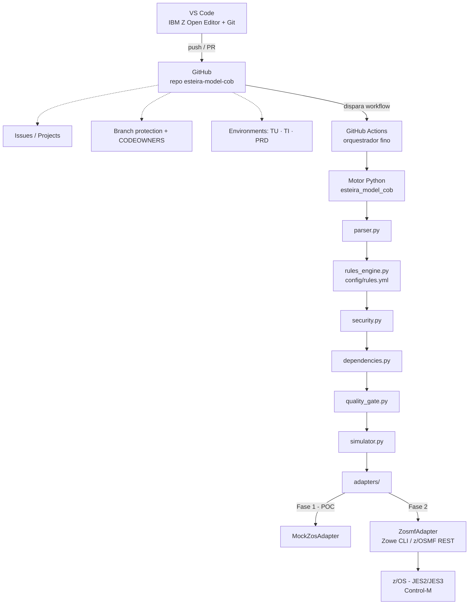

# Arquitetura

## Princípio orientador

O JCL não muda. A troca é na camada de orquestração e governança — de
Jira/HexaVision/ChangeMan para GitHub/GitHub Actions/Python — preservando a
lógica atual, os JCLs e o Control-M.

## Mapeamento esteira atual → nova esteira

| Etapa atual | Ferramenta hoje | Nova esteira |
|---|---|---|
| Desenho e planejamento | Jira | GitHub Issues / Projects |
| Desenvolvimento | HexaVision | VS Code + Git |
| SCM | HexaVision | GitHub Repository |
| Build / empacotamento | ChangeMan ZMF | GitHub Actions + Python |
| Repositório de pacotes | Repositório de binários | GitHub Artifacts / Releases |
| Gestão de configuração | Controle de conflito de fontes | Git + YAML (`config/`) |
| Deploy | ChangeMan ZMF | GitHub Actions + `esteira_model_cob` |
| TU / TI / PR | Jira (rastreio) | GitHub Environments `TU` / `TI` / `PRD` |
| Gates | HexaVision (Dresscode) | GitHub Environment + Rules Engine em Python |
| Auditoria | Jira / HexaVision | GitHub Audit Log + JCL Pipeline Report |
| Execução z/OS | Control-M / operação manual | z/OSMF / Zowe (Fase 2) |
| Control-M | — | Permanece inalterado |
| JCL | — | Permanece inalterado |

## Diagrama

## Por que o motor fica em Python, não no YAML do workflow

O GitHub Actions controla *quando* a execução começa, qual runner é usado,
quais aprovações são necessárias e o status do Pull Request. O motor Python
controla *toda a lógica*: parsing, regras, dependências, score, simulação,
submissão e evidências. Isso evita acoplamento ao GitHub Actions — a mesma
esteira poderia rodar sob Azure DevOps, Jenkins ou como CLI local, trocando
apenas a camada de disparo.

## Fases do projeto

- **Fase 1 (este repositório)** — novo SCM e nova esteira. Retira Jira e
  HexaVision da criação/versionamento; preserva os JCLs; convive com as
  validações do HexaVision ainda não substituídas.
- **Fase 2** — substituição das validações do HexaVision, após inventário e
  classificação completa das regras (técnica, processo, segurança, negócio,
  regulatória) — ver `kickoff-perguntas.md`.

## Ambiente de validação

O GitHub Actions hospedado pela GitHub roda o `pytest` e o wrapper do
ProLeap (via `actions/setup-java`), mas não alcança rede interna. Para
provar a esteira rodando "dentro da rede do banco" — o nó "Self-hosted
Runner" deste diagrama — e para validar manualmente tudo o que uma máquina
de desenvolvimento corporativa às vezes não permite instalar (JDK, Maven,
`gh` CLI), ver `ambiente-validacao.md`.
