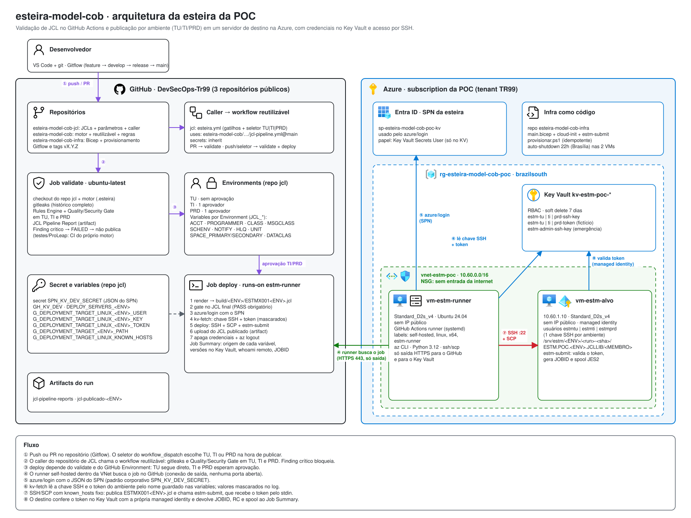

# Esteira da POC: como funciona e para que serve



> O diagrama é gerado por `scripts/gen_arquitetura.py`. Para editar, abra
> [`arquitetura/esteira-poc.excalidraw`](arquitetura/esteira-poc.excalidraw)
> no [excalidraw.com](https://excalidraw.com) ou na extensão *Excalidraw* do
> VS Code. Para manter o SVG em sincronia, altere o script e rode
> `python scripts/gen_arquitetura.py`.

## 1. Para que serve

A POC demonstra, de ponta a ponta, como trocar a orquestração atual de JCL
(Jira + ferramenta de regras + ChangeMan/Endevor) por **GitHub + GitHub
Actions**. A demonstração cobre:

| Pergunta | Como a POC responde |
|---|---|
| Como impedir que um JCL ruim chegue ao ambiente? | Job `validate`: Rules Engine + Quality/Security Gate. Um finding crítico reprova o JCL antes de qualquer credencial ser usada. |
| Como manter **um** JCL para vários ambientes? | Modelo único (`jcl/ESTMX001.jcl`) com placeholders. Os valores vêm das variables do GitHub Environment de cada ambiente. |
| Quem aprova a publicação em TI e PRD? | GitHub Environments com required reviewers. TU publica direto. |
| Onde ficam as credenciais? | No Azure Key Vault. O GitHub guarda só o **nome** do segredo e a credencial do SPN que pode lê-lo. |
| Como a esteira chega a um servidor sem expô-lo à internet? | Por um runner self-hosted na mesma VNet. O destino não tem IP público. |
| Como provar que a credencial foi usada de verdade? | O Job Summary mostra a versão e o hash parcial de cada segredo, além do `hostname`/`whoami` do servidor. O próprio destino valida o token no Key Vault antes de aceitar o JCL. |

O servidor de destino é um Linux que **simula** o mainframe. Ele recebe o
JCL, grava o membro na "biblioteca" do ambiente e devolve JOBID e spool no
formato JES2. Na Fase 2, essa ponta vira o z/OSMF real
(`docs/integracao-zos.md`), e o resto da esteira continua igual.

## 2. Componentes

### 2.1 Repositório e motor Python

`DevSecOps-Tr99/esteira-model-cob` (público). Segue o Gitflow descrito em
`docs/gitflow.md`: `feature/*` → `develop` → `release/*` → `main`, com tags
`vX.Y.Z`.

Toda a lógica fica no pacote `esteira_model_cob`. O workflow só chama
`python -m esteira_model_cob <comando>`.

| Comando | O que faz |
|---|---|
| `validate` | Parser + Rules Engine (`config/rules.yml`) + Quality Gate (nota 0–100) + Security Gate |
| `simulate` | Submissão simulada (`MockZosAdapter`), usada só no job `validate` |
| `report` | Gera o JCL Pipeline Report com a biblioteca-alvo do ambiente |
| `binary-guard` | Procura bytes de controle hard-coded em conteúdo EBCDIC |
| `render` | Gera o JCL final de um ambiente (`build/<ENV>/<MEMBRO><ENV>.jcl`) e registra a origem de cada valor |
| `kv-fetch` | Lê os segredos no Key Vault, mascara no log e grava em arquivos `0600` |
| `deploy` | Faz SSH, SCP e `estm-submit` no destino e escreve o Job Summary |

### 2.2 Workflow `.github/workflows/jcl-validation.yml`

| Gatilho | Jobs que rodam | Ambiente |
|---|---|---|
| `pull_request` (jcl, proc, cobol, config, código, testes) | `validate` | nenhum |
| `push` em `develop` | `validate` → `deploy` | TU |
| `push` em `release/*` | `validate` → `deploy` | TI |
| `push` em `main` ou `hotfix/*` | `validate` → `deploy` | PRD |
| `workflow_dispatch` (Actions → *Run workflow*) | `validate` → `deploy` | **seletor** TU / TI / PRD + caminho do JCL |

**Job `validate`** (`ubuntu-latest`, runner hospedado pelo GitHub):

1. gitleaks no histórico completo (`fetch-depth: 0`); exceções revisadas em `.gitleaksignore`;
2. JDK 17 + build do ProLeap a partir do fonte;
3. `pytest`;
4. demonstração ao vivo: `validate`, `simulate` e `binary-guard`;
5. JCL Pipeline Report como artifact.

**Job `deploy`** (`runs-on: [self-hosted, linux, x64, estm-runner]`, `environment:` TU/TI/PRD):

1. `render`: modelo → `build/<ENV>/ESTMX001<ENV>.jcl`;
2. `validate` no arquivo final. Se der FAILED, o job para aqui;
3. `azure/login` com `secrets.SPN_KV_DEV_SECRET`;
4. `kv-fetch`: chave SSH + token do ambiente;
5. `deploy`: SSH, SCP e `estm-submit`;
6. upload do JCL publicado (`jcl-publicado-<ENV>`);
7. `always()`: apaga as credenciais do disco do runner e faz `az logout`.

### 2.3 GitHub Environments

| Environment | Proteção | Variables próprias |
|---|---|---|
| `TU` | nenhuma | `JCL_*` com valores de TU |
| `TI` | 1 aprovador | `JCL_*` com valores de TI |
| `PRD` | 1 aprovador | `JCL_*` com valores de PRD |

O job `deploy` só começa depois da aprovação. Quem aprova vê o run, o commit
e o ambiente em *Review deployments*.

### 2.4 Runner self-hosted (`vm-estm-runner`)

- Ubuntu 24.04, `Standard_D2s_v4`, **sem IP público**.
- O runner do GitHub Actions roda como serviço systemd, com o usuário
  `ghrunner` e as labels `self-hosted, linux, x64, estm-runner`.
- Tem az CLI, Python 3.12 e cliente ssh/scp. Os pacotes são instalados pelo
  cloud-init em `infra/runner/cloud-init.yaml`.
- Só faz conexões de **saída**: HTTPS para o GitHub (para buscar jobs) e
  para o Key Vault. Nenhuma porta de entrada é aberta.

### 2.5 Servidor de destino (`vm-estm-alvo`)

- IP fixo `10.60.1.10`, sem IP público, com **managed identity**.
- Tem um usuário por ambiente: `estmtu`, `estmti` e `estmprd`. Cada um
  aceita só a própria chave SSH e escreve só em `/srv/estm/<ENV>`. O `sshd`
  aceita apenas chave, sem senha nem root.
- `estm-submit` (`infra/alvo/estm-submit.py`) faz o papel do z/OSMF:
  1. lê o token pelo stdin;
  2. busca o token esperado no Key Vault com a managed identity e compara.
     Se não bater, recusa com rc 3;
  3. recusa um usuário que tente publicar em outro ambiente (rc 4);
  4. grava o membro em `/srv/estm/<ENV>/ESTM.POC.<ENV>.JCLLIB/<MEMBRO>`;
  5. gera `JOBnnnnn` e um spool JES2 e devolve tudo em JSON;
  6. registra a operação, aceita ou recusada, em `/var/lib/estm/auditoria.log`.

### 2.6 Key Vault (`kv-estm-poc-*`)

RBAC, soft delete de 7 dias.

| Segredo | Quem lê |
|---|---|
| `estm-tu-ssh-key`, `estm-ti-ssh-key`, `estm-prd-ssh-key` | SPN da esteira |
| `estm-tu-token`, `estm-ti-token`, `estm-prd-token` (fictícios) | SPN da esteira e a managed identity do destino |
| `estm-admin-ssh-key` | só quem provisiona (acesso de emergência às VMs) |

### 2.7 Identidades

| Identidade | Papel | Escopo |
|---|---|---|
| SPN `sp-esteira-model-cob-poc-kv` (Entra ID) | Key Vault Secrets User | só o Key Vault |
| Managed identity de `vm-estm-alvo` | Key Vault Secrets User | só o Key Vault |
| Quem provisiona (usuário) | Key Vault Secrets Officer | só o Key Vault |

### 2.8 Rede

`vnet-estm-poc` `10.60.0.0/16`, sub-rede `snet-poc` `10.60.1.0/24`, NSG
**sem regra de entrada**. As regras padrão do Azure negam tudo que vem da
internet e liberam o tráfego dentro da VNet, que é o caminho
runner → destino:22. A saída usa o *default outbound access* da sub-rede,
sem NAT Gateway, o que basta para a POC.

## 3. O JCL por ambiente

O modelo `jcl/ESTMX001.jcl` segue o formato dos jobs reais:
- job card com conta, programador, `CLASS`, `MSGCLASS`, `SCHENV` e `NOTIFY`;
- `JOBLIB`;
- `SORT` com GDG `(0)` → `(+1)`, `UNIT`, `SPACE` e `DATACLAS`.

Cada parâmetro que muda por ambiente é um placeholder `${NOME}`.

**De onde vem o valor**, em ordem de precedência:

1. a variable `JCL_<NOME>` do GitHub Environment do ambiente (só existe dentro do job `deploy`);
2. a entrada do job em `config/jcl_env_params.yml`, que é o padrão para rodar local e no job `validate`.

Se um placeholder ficar sem valor nas duas fontes, o `render` falha e diz
qual variable criar. É impossível publicar um JCL com `${...}` sobrando.

**Nome do arquivo**: `config/deploy_targets.yml` → `file_naming: "{member}{env}.jcl"`.
O resultado é `ESTMX001TU.jcl`, `ESTMX001TI.jcl` e `ESTMX001PRD.jcl`. No
destino, o conteúdo vira o membro `ESTMX001`, sem sufixo, da biblioteca do
ambiente (`config/deploy_targets.yml` → `library`).

O Job Summary do passo **Renderizar** mostra uma tabela com
`placeholder | valor | origem` e o JCL final.

## 4. Segurança

| Risco | Controle |
|---|---|
| Segredo no código | gitleaks em todo PR e push, com histórico completo; `.gitleaksignore` só com falsos positivos justificados |
| Credencial no log | `::add-mask::` em cada linha do segredo; o summary mostra só a versão e o SHA-256 parcial |
| Credencial esquecida no runner persistente | arquivos `0600` em `$RUNNER_TEMP`, apagados em `always()`, seguido de `az logout` |
| Token visível em `ps` no destino | o token vai pelo **stdin** do SSH, nunca como argumento |
| Man-in-the-middle no SSH | `StrictHostKeyChecking=yes` com `known_hosts` fixo (variable `G_DEPLOYMENT_TARGET_LINUX_KNOWN_HOSTS`) |
| Ambiente errado | um usuário SSH e uma chave por ambiente; `estm-submit` recusa usuário de outro ambiente |
| Destino exposto | sem IP público, NSG sem entrada, `sshd` só com chave |
| Privilégio excessivo | SPN e managed identity só com *Secrets User* no Key Vault, nada na subscription |
| Repositório público | PR de fork exige aprovação para rodar workflow; `GITHUB_TOKEN` padrão só leitura; `deploy` nunca roda em `pull_request` |
| Publicação sem revisão | TI e PRD exigem aprovação no Environment |

## 5. Operação

### Ligar e desligar

As duas VMs desligam sozinhas às 22h (horário de Brasília). Com o runner
desligado, o job `deploy` fica na fila. Para ligar:

```
az vm start -g rg-esteira-model-cob-poc -n vm-estm-runner
az vm start -g rg-esteira-model-cob-poc -n vm-estm-alvo
```

### Demonstração

1. Actions → **JCL Pipeline** → **Run workflow** → escolha a branch e `ambiente = TU`.
2. Abra o run e, no **Summary**, mostre as quatro tabelas: renderização, Key Vault, SSH e submissão.
3. Rode com `TI`. O `deploy` para em *Waiting for review*. Aprove e compare
   `HLQ`, `SCHENV`, o usuário `estmti` e a pasta `/srv/estm/TI`.
4. Rode com `PRD`: `CLASS=P`, `MSGCLASS=Z`, `UNIT=DISCO` e `SPACE` maior.
5. Mude `JCL_SPACE_PRIMARY` no Environment TI (Settings → Environments → TI)
   e rode de novo. Só o JCL de TI muda, e o summary mostra a origem
   *GitHub variables*.
6. Abra um PR que coloca `DELETE PROD.` em um JCL. O `validate` reprova com
   CRITICAL e não existe job `deploy` em PR.

### Provisionar do zero

```
powershell -ExecutionPolicy Bypass -File infra/provisionar.ps1 -Subscription <id>
```

Requer `az` logado com Owner na subscription, `gh` logado como admin do
repositório, `ssh-keygen` e um Python com PyYAML. O script é idempotente:
reaproveita as chaves que já estão no Key Vault e preserva os tokens. Passos
e parâmetros estão no cabeçalho do script.

Se a região estiver sem capacidade para o tamanho padrão de VM, use
`-VmSize <outro>`. A série B não está liberada para a subscription da POC
em brazilsouth.

### Destruir

```
az group delete -n rg-esteira-model-cob-poc
az keyvault purge -n <kv>            # soft delete de 7 dias
az ad sp delete --id <appId>
```

No GitHub, apague o runner offline em Settings → Actions → Runners. Os
Environments, as variables e o secret podem ficar para o próximo
provisionamento.

### Rotacionar credenciais

| O quê | Como |
|---|---|
| Token de um ambiente | grave uma nova versão de `estm-<env>-token` no Key Vault. Os dois lados leem do Key Vault, então nada mais muda |
| Chave SSH de um ambiente | gere o par, troque o `authorized_keys` do usuário no destino (via `az vm run-command`) e grave a nova privada em `estm-<env>-ssh-key` |
| Secret do SPN | rode o `provisionar.ps1` de novo, que cria uma senha nova e atualiza `SPN_KV_DEV_SECRET` |

### Adicionar um JCL ou um parâmetro

1. Crie `jcl/<MEMBRO>.jcl` usando `${NOME}` onde o valor muda por ambiente.
2. Coloque os valores em `config/jcl_env_params.yml` (entrada `<MEMBRO>`) e,
   se quiser controlar pelo GitHub, crie `JCL_<NOME>` em cada Environment.
3. Publique com o seletor, informando o caminho do JCL no campo `jcl`.

## 6. Problemas já encontrados

| Sintoma | Causa | Correção |
|---|---|---|
| `SkuNotAvailable` / `AllocationFailed` no Bicep | série B não liberada e v7 sem capacidade em brazilsouth | padrão `Standard_D2s_v4`, sobrescrevível com `-VmSize`; apague as VMs em estado *Failed* antes de repetir |
| gitleaks reprova IDs de papel do Azure | regra genérica de API key | fingerprint no `.gitleaksignore`, com a justificativa |
| `kv-fetch` com `Forbidden` logo após provisionar | propagação do RBAC do Key Vault | aguardar 1–2 minutos (o script já tenta de novo) |
| `deploy` parado em *Queued* | runner desligado pelo auto-shutdown | `az vm start` nas duas VMs |
| `Host key verification failed` | destino recriado, com host key nova | rodar o `provisionar.ps1`, que atualiza `G_DEPLOYMENT_TARGET_LINUX_KNOWN_HOSTS` |
| `estm-submit` rc 3 | token do GitHub e do Key Vault diferentes, ou variable `_TOKEN` com nome errado | conferir a variable e a versão no summary |

## 7. Relação com a esteira corporativa

A POC usa **os mesmos nomes de variable e secret** do padrão corporativo
de deploy Linux: `SPN_KV_DEV_SECRET`, `GH_KV_DEV`, `DEPLOY_SERVERS_<ENV>`,
`G_DEPLOYMENT_TARGET_LINUX_<ENV>_USER`/`_KEY` e
`G_DEPLOYMENT_TARGET_<ENV>_PATH`. A sequência também é a mesma:
`azure/login` → segredo no Key Vault pelo nome da variable → SSH.

As diferenças são deliberadas, porque a POC precisa rodar fora da
plataforma corporativa:

| POC | Esteira corporativa |
|---|---|
| Lógica no próprio workflow do repo | Caller fino → reusable workflow versionado (`@latest`) com Self Update |
| `kv-fetch` / `deploy` próprios (Python) | Actions internas de Key Vault e de deploy Linux |
| gitleaks público | Secret scan interno + SAST + Sonar |
| Artifact do GitHub | Repositório de artefatos (snapshot → retag release) |
| TU / TI / PRD, um Key Vault | DEV / HOM / PRD, Key Vault e SPN por ambiente |
| 1 aprovador em TI e PRD | HOM e PRD com aprovação de PR, Environment e change |
| Destino Linux simulado | Build e deploy no mainframe |
| Sem rollback nem change-velocity | Rollback de PRD e integração com gestão de mudanças |

Os requisitos para levar o gate e a publicação de JCL para a sandbox
corporativa são tratados fora deste repositório, na documentação do
repositório corporativo.

## 8. Limitações e próximos passos

- Na Fase 2, o destino simulado dá lugar ao z/OSMF/Zowe
  (`docs/integracao-zos.md`). O contrato do `estm-submit`
  (token → JOBID/RC/spool) é o mesmo que o `ExecutionAdapter` real vai cumprir.
- Um Key Vault e um SPN por ambiente, para espelhar o padrão corporativo.
- PRD com 2 aprovadores e regra de branch: só `main`/`hotfix/*` publicam em PRD.
- Rollback de PRD usando a publicação anterior (`/srv/estm/PRD/<run>-<sha>`).
- NAT Gateway ou Private Endpoint no Key Vault, se o ambiente precisar de
  saída controlada.

Referência de infra (tabelas de variables e segredos): `docs/ambiente-poc-azure.md`.
