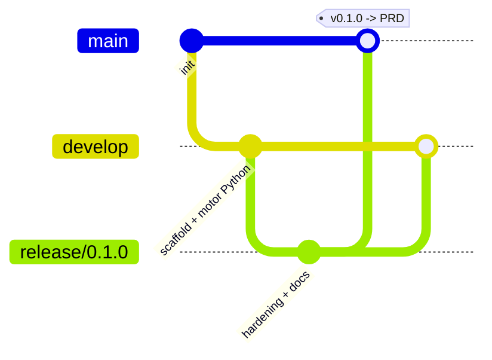

# Gitflow neste repositório

O Gitflow mapeia naturalmente para os três ambientes já usados na esteira
atual (TU/TI/PR), o que facilita a conversa de governança com Change
Management.

## Branches ↔ ambientes

| Branch Gitflow | Ambiente / gate | Regra de proteção |
|---|---|---|
| `feature/*` | Local + Gate de Qualidade no PR | PR obrigatório para `develop`, revisão de CODEOWNERS |
| `develop` | `environment: TU` | Deploy automático após merge; testes obrigatórios |
| `release/*` | `environment: TI` | Gate Análise de Conflitos; só bugfix, sem feature nova |
| `main` | `environment: PRD` | Required reviewer, change aprovado, artefato imutável |
| `hotfix/*` | PRD direto, com merge de volta em `develop` | Mesma aprovação de `release/*` |

## Diagrama



## Como usar no dia a dia

### Abrir uma feature

```bash
git checkout develop
git pull
git checkout -b feature/nome-da-feature
# ... commits ...
git push -u origin feature/nome-da-feature
# abrir PR contra develop
```

### Cortar um release

Quando `develop` acumula features suficientes para ir para TI:

```bash
git checkout develop
git checkout -b release/X.Y.0
# só correções pontuais aqui - sem features novas
git push -u origin release/X.Y.0
```

Passa pelo Gate Análise de Conflitos (`environment: TI`). Quando aprovado:

```bash
git checkout main
git merge --no-ff release/X.Y.0
git tag vX.Y.0
git push origin main --tags

git checkout develop
git merge --no-ff release/X.Y.0
git push origin develop

git branch -d release/X.Y.0
```

### Aplicar um hotfix

Para uma correção urgente direto em produção:

```bash
git checkout main
git checkout -b hotfix/X.Y.Z
# ... correção ...
git checkout main
git merge --no-ff hotfix/X.Y.Z
git tag vX.Y.Z
git push origin main --tags

git checkout develop
git merge --no-ff hotfix/X.Y.Z
git push origin develop

git branch -d hotfix/X.Y.Z
```

## Exemplo real deste repositório

O histórico deste próprio repositório segue esse fluxo desde o primeiro
commit: o scaffold inicial foi commitado em `develop`, promovido via
`release/0.1.0` e mesclado em `main` com a tag `v0.1.0` — rode
`git log --oneline --graph --all` para ver a forma exata.
